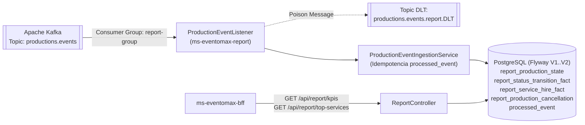

# ms-eventomax-report — Microservicio CQRS de Analítica, KPIs y Ranking de Servicios vía Kafka (EP2)

**Asignatura:** Desarrollo Cloud Native I (`DSY1107`)
**Caso de Estudio:** Caso 8 — Plataforma de Producción y Montaje de Eventos (**EventoMax**)
**Equipo:** Ignacio Valeria, Benjamín Flores, Benjamín Espinoza

---

## 1. Propósito del Repositorio y Rol en EventoMax

`ms-eventomax-report` implementa el modelo de lectura analítico (**CQRS Read Model**) de **EventoMax EP2**. Consume de forma asíncrona e idempotente los eventos de dominio publicados en **Apache Kafka** (`productions.events`) por `ms-eventomax-productions` y proyecta indicadores clave de rendimiento (KPIs de estados de producción y tiempos de confirmación) así como el ranking de servicios más contratados (`top-services`).

---

## 2. Arquitectura del Módulo y Diagrama



---

## 3. Stack Tecnológico y Versiones Reales (`pom.xml`)

| Componente | Tecnología / Dependencia | Versión |
|---|---|---|
| Lenguaje | Java (Eclipse Temurin) | `25` |
| Framework Base | Spring Boot (`spring-boot-starter-parent`) | `4.1.1` |
| Mensajería de Eventos | `spring-kafka` | Boot `4.1.1` |
| Persistencia | Spring Data JPA + PostgreSQL + Flyway (`V1`, `V2`) | Boot `4.1.1` |
| Seguridad | `spring-boot-starter-security` + `oauth2-resource-server` | Boot `4.1.1` |
| Testing | JUnit 5, Testcontainers (`2.0.5`, PostgreSQL + Kafka), MockMvc | Boot `4.1.1` |

---

## 4. Cumplimiento de Rúbrica EP2 (Matriz Caso 8)

| Criterio de Evaluación EP2 | Implementación en `ms-eventomax-report` | Estado |
|---|---|---|
| **Coexistencia Arquitectónica Kafka + RabbitMQ** | Mientras RabbitMQ procesa comandos operativos hacia Notify, Report consume eventos de dominio en Kafka (`productions.events`) sin acoplamiento directo con Productions. | **CUMPLIDO** |
| **Idempotencia y Tolerancia a Desorden** | Deduplicación atómica en `processed_event` (`INSERT ... ON CONFLICT DO NOTHING`) y manejo de eventos `ProductionServiceContracted`, `ProductionServiceRemoved` y `ProductionStatusChanged` incluso fuera de orden. | **CUMPLIDO** |
| **Manejo de Poison Messages (DLT)** | `DefaultErrorHandler` con `DeadLetterPublishingRecoverer` hacia `productions.events.report.DLT`. | **CUMPLIDO** |
| **Seguridad JWT Microsoft Entra ID** | Validación de `issuer`, `audience`, scope `access_as_user` y acceso exclusivo para roles `Admin` y `Auditor`. | **CUMPLIDO** |

---

## 5. Endpoints Expuestos

| Método | Ruta | Roles Autorizados | Descripción |
|---|---|---|---|
| `GET` | `/api/report/kpis?from=YYYY-MM-DD&to=YYYY-MM-DD` | `Admin`, `Auditor` | Devuelve totales de producciones por estado, tasa de cancelación y tiempo promedio de confirmación en el rango UTC consultado. |
| `GET` | `/api/report/top-services?from=YYYY-MM-DD&to=YYYY-MM-DD` | `Admin`, `Auditor` | Devuelve el ranking ordenado de servicios contratados en producciones no canceladas dentro del rango de fechas. |
| `GET` | `/actuator/health`, `/actuator/info` | Público (Healthcheck interno) | Estado de salud del microservicio. |

---

## 6. Base de Datos y Migraciones Flyway

| Versión | Archivo | Descripción |
|---|---|---|
| `V1` | `V1__init_report_schema.sql` | Crea tablas `report_production_state`, `report_status_transition_fact` y `processed_event`. |
| `V2` | `V2__add_service_hires_read_model.sql` | Crea tablas `report_service_hire_fact` y `report_production_cancellation` para el ranking de servicios contratados (`T01`). |

---

## 7. Variables de Entorno Requeridas

| Variable | Ejemplo Placeholder | Descripción |
|---|---|---|
| `DB_URL` | `jdbc:postgresql://localhost:5434/eventomax_report` | URL JDBC PostgreSQL |
| `DB_USER` | `report_user` | Usuario PostgreSQL |
| `DB_PASSWORD` | `<SECRET_DB_PASSWORD>` | Contraseña PostgreSQL |
| `KAFKA_BOOTSTRAP_SERVERS` | `kafka:9092` | Brokers Apache Kafka |
| `KAFKA_CONSUMER_GROUP` | `report-group` | Consumer group de Report |
| `KAFKA_TOPIC_PRODUCTION_EVENTS` | `productions.events` | Tópico de entrada |
| `KAFKA_TOPIC_REPORT_DLT` | `productions.events.report.DLT` | Tópico Dead Letter |
| `ENTRA_ISSUER_URI` | `https://login.microsoftonline.com/<TENANT_ID>/v2.0` | Issuer URI de Microsoft Entra ID |
| `ENTRA_AUDIENCE` | `api://a1a87bcd-fed7-4d65-83c3-338389b80093` | Audience del API en Entra ID |

---

## 8. Ejecución Local y Pruebas Automatizadas

```bash
# Ejecutar suite completa de pruebas unitarias e integración con Testcontainers efímeros (59 tests)
mvn clean test
```

**Resultado certificado en EP2:** `Tests run: 59, Failures: 0, Errors: 0, Skipped: 0 — BUILD SUCCESS`.

---

## 9. Construcción y Despliegue Docker

```bash
docker build -t ms-eventomax-report:ep2 .
docker compose -f docker-compose.prod.yml up -d --build
```

---

## 10. Estado Actual de Certificación EP2 y Trazabilidad Jira

- **Pruebas Automatizadas:** `59/59` aprobadas (`ReportIntegrationTest`, `ProductionEventIngestionServiceTest`, `ReportControllerSecurityTest`, `ReportServiceImplTest`).
- **Historias Jira:** `EMX-68` (Servicio de Reportes y KPIs Kafka), `T01` (Proyección y endpoint `/api/report/top-services`).
