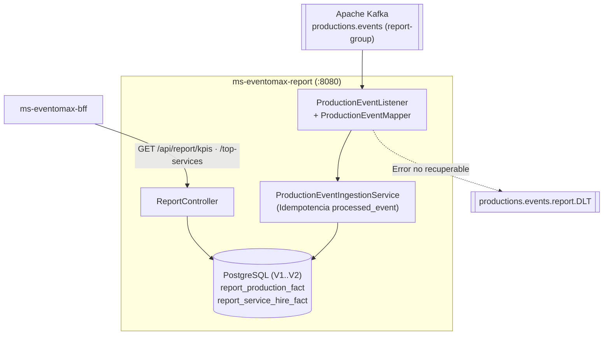

<a href="https://7dewsdyt7i.execute-api.us-east-1.amazonaws.com/kafka-ui/">
  
</a>

> **Caso de Estudio 8:** Plataforma B2B de Producción y Montaje de Eventos &nbsp;|&nbsp; **Asignatura:** Desarrollo Cloud Native (`DSY1107`) &nbsp;|&nbsp; **Equipo:** Ignacio Valeria, Benjamín Flores, Benjamín Espinoza

## Propósito del Repositorio

`ms-eventomax-report` implementa el modelo de lectura analítico (**CQRS Read Model**) de **EventoMax**. Consume en streaming los eventos de dominio publicados por `ms-eventomax-productions` en **Apache Kafka** (`productions.events`) y mantiene proyecciones SQL optimizadas para el dashboard operativo y los reportes ejecutivos:

- **Ingesta Idempotente y Tolerante a Fallos:** `ProductionEventListener` (`group-id: report-group`) valida cada sobre con `ProductionEventMapper` y delega en `ProductionEventIngestionService`, deduplicando eventos por `eventId` en `processed_event` y derivando mensajes irrecuperables hacia `productions.events.report.DLT`.
- **Proyecciones Analíticas Agregadas:** Calcula totales de producciones, tasa de cancelación, tiempo promedio de montaje/confirmación, conteo diario de eventos y ranking de servicios más contratados (`top-services`) por ventana temporal (`range`).
- **Cobertura Transparente (`partialCoverage`):** Si una consulta corresponde a una ventana sin eventos proyectados todavía, informa explícitamente el estado parcial en la respuesta sin inventar métricas.

## Accesos Relacionados (Demo AWS)

| Recurso | Enlace HTTPS | Acceso |
| :--- | :--- | :--- |
| **Apache Kafka UI** | [Abrir Kafka UI](https://7dewsdyt7i.execute-api.us-east-1.amazonaws.com/kafka-ui/) | Sin login (ver tópico `productions.events`, `report-group` y `.DLT`) |
| **Swagger UI (Tag `Reportes`)** | [Abrir Swagger UI](https://7dewsdyt7i.execute-api.us-east-1.amazonaws.com/swagger-ui/index.html) | Lectura pública · `Bearer <JWT>` rol `Admin` |

## Endpoints Expuestos (`expose 8080`)

| Método | Ruta | Rol Autorizado (vía BFF) | Descripción |
| :--- | :--- | :--- | :--- |
| `GET` | `/api/report/kpis?range=last24h` | `Admin` | KPIs agregados de estados, cancelaciones, tiempo promedio de montaje y conteo diario |
| `GET` | `/api/report/top-services?range=last7d` | `Admin` | Ranking ordenado de servicios técnicos contratados dentro de la ventana temporal |
| `GET` | `/actuator/health`, `/actuator/info` | Interno | Sondeo de salud del contenedor |

## Base de Datos y Migraciones Flyway (`V1..V2`)

| Versión | Script | Tablas Proyectadas |
| :--- | :--- | :--- |
| `V1` | `V1__create_report_read_model.sql` | `processed_event` (idempotencia) y `report_production_fact` |
| `V2` | `V2__create_report_service_hire_fact.sql` | `report_production_cancellation` y `report_service_hire_fact` |

## Stack Tecnológico

<table>
  <tr>
    <td align="center" width="20%">
      <br />
      <strong>Java 25 · Boot 4.1.1</strong>
    </td>
    <td align="center" width="20%">
      <picture>
        <source media="(prefers-color-scheme: dark)" srcset="docs/assets/tech/apache-kafka-dark.svg" />
        
      </picture><br />
      <strong>Spring Kafka + DLT</strong>
    </td>
    <td align="center" width="20%">
      <br />
      <strong>PostgreSQL · Flyway</strong>
    </td>
    <td align="center" width="20%">
      <br />
      <strong>Entra ID OAuth2</strong>
    </td>
    <td align="center" width="20%">
      <br />
      <strong>Docker (512m)</strong>
    </td>
  </tr>
</table>

## Arquitectura del Módulo



## Variables de Entorno y Verificación

| Variable | Ejemplo | Descripción |
| :--- | :--- | :--- |
| `DB_URL` / `DB_USER` / `DB_PASSWORD` | `jdbc:postgresql://<HOST>:5432/eventomax?currentSchema=report` | Conexión PostgreSQL y esquema `report` |
| `KAFKA_BOOTSTRAP_SERVERS` | `ec2-kafka:9092` | Brokers del clúster Apache Kafka |
| `KAFKA_CONSUMER_GROUP` | `report-group` | Consumer group del Read Model |
| `KAFKA_CONSUMER_AUTO_STARTUP` | `true` (en entorno Kafka activo) / `false` (solo lectura DB) | Controla auto-inicio del listener Kafka |
| `KAFKA_TOPIC_PRODUCTION_EVENTS` / `REPORT_DLT` | `productions.events` / `productions.events.report.DLT` | Tópicos fuente y Dead Letter |
| `ENTRA_ISSUER_URI` / `ENTRA_AUDIENCE` | `https://login.microsoftonline.com/<TENANT>/v2.0` | Validación JWT Entra ID |

```bash
# Ejecutar suite completa con Testcontainers PostgreSQL y Kafka
./mvnw -B -ntp verify

# Despliegue Docker (mem_limit: 512m)
docker compose --env-file .env.prod -f docker-compose.prod.yml up -d --build
```
