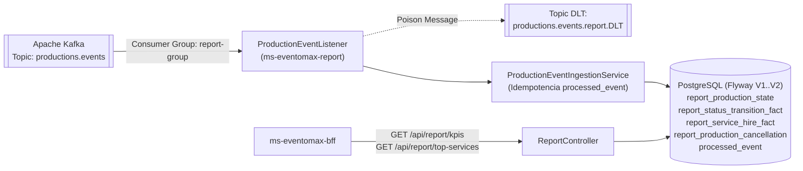

# ms-eventomax-report — Microservicio CQRS de Analítica, KPIs y Ranking de Servicios vía Kafka (EP2)

**Asignatura:** Desarrollo Cloud Native I (`DSY1107`)
**Caso de Estudio:** Caso 8 — Plataforma de Producción y Montaje de Eventos (**EventoMax**)
**Equipo:** Ignacio Valeria, Benjamín Flores, Benjamín Espinoza

---

## 1. Propósito del Repositorio y Rol en EventoMax

`ms-eventomax-report` implementa el modelo de lectura analítico (**CQRS Read Model**) de **EventoMax EP2**. Consume de forma asíncrona e idempotente los eventos de dominio publicados en **Apache Kafka** (`productions.events`) por `ms-eventomax-productions` y proyecta indicadores clave de rendimiento (KPIs de estados de producción y tiempos de confirmación) así como el ranking de servicios más contratados (`top-services`).

En despliegues AWS EC2 donde Kafka se mantiene apagado para preservar memoria de la instancia `t3.large` (dado que el foco evaluativo de EP2 es RabbitMQ), `ms-eventomax-report` inicia limpiamente con `KAFKA_CONSUMER_AUTO_STARTUP=false` y sirve sus endpoints HTTP `/api/report/kpis` y `/api/report/top-services` directamente desde su esquema PostgreSQL (`report`).

---

## 2. Arquitectura del Módulo y Diagrama



---

## 3. Stack Tecnológico y Versiones Reales (`pom.xml`)

| Componente | Tecnología / Dependencia | Versión |
|---|---|---|
| Lenguaje | Java (Eclipse Temurin) | `25` |
| Framework Base | Spring Boot (`spring-boot-starter-parent`) | `4.1.1` |
| Mensajería de Eventos | `spring-kafka` | Boot `4.1.1` |
| Persistencia | Spring Data JPA + PostgreSQL + Flyway (`V1`, `V2`) | Boot `4.1.1` |
| Seguridad | `spring-boot-starter-security` + `oauth2-resource-server` | Boot `4.1.1` |
| Testing | JUnit 5, Testcontainers (`2.0.5`, PostgreSQL + Kafka), MockMvc | Boot `4.1.1` |

---

## 4. Endpoints Expuestos

| Método | Ruta | Roles Autorizados | Descripción |
|---|---|---|---|
| `GET` | `/api/report/kpis?from=YYYY-MM-DD&to=YYYY-MM-DD` | `Admin`, `Auditor` | Devuelve totales de producciones por estado, tasa de cancelación y tiempo promedio de confirmación en el rango UTC consultado. |
| `GET` | `/api/report/top-services?from=YYYY-MM-DD&to=YYYY-MM-DD` | `Admin`, `Auditor` | Devuelve el ranking ordenado de servicios contratados en producciones no canceladas dentro del rango de fechas. |
| `GET` | `/actuator/health`, `/actuator/info` | Público (Healthcheck interno) | Estado de salud del microservicio. |

---

## 5. Variables de Entorno Requeridas (`.env.prod.example`)

| Variable | Ejemplo Placeholder | Descripción |
|---|---|---|
| `DB_URL` | `jdbc:postgresql://<POSTGRES_HOST>:5432/eventomax?currentSchema=report` | URL JDBC PostgreSQL |
| `DB_USER` | `eventomax_prod` | Usuario PostgreSQL |
| `DB_PASSWORD` | `<SECRET_DB_PASSWORD>` | Contraseña PostgreSQL |
| `KAFKA_BOOTSTRAP_SERVERS` | `kafka:9092` | Brokers Apache Kafka |
| `KAFKA_CONSUMER_AUTO_STARTUP` | `false` (en EC2 sin Kafka) o `true` (con Kafka activo) | Controla el auto-inicio del listener Kafka |
| `ENTRA_ISSUER_URI` | `https://login.microsoftonline.com/<TENANT_ID>/v2.0` | Issuer URI de Microsoft Entra ID |
| `ENTRA_AUDIENCE` | `api://a1a87bcd-fed7-4d65-83c3-338389b80093` | Audience del API en Entra ID |

---

## 6. Ejecución de Pruebas Automatizadas y Despliegue Docker

```bash
mvn clean verify
docker compose --env-file .env.prod -f docker-compose.prod.yml up -d --build
```

**Resultado certificado en EP2:** `Tests run: 59, Failures: 0, Errors: 0, Skipped: 0 — BUILD SUCCESS`. Presupuesto de memoria: `mem_limit: 512m`.
